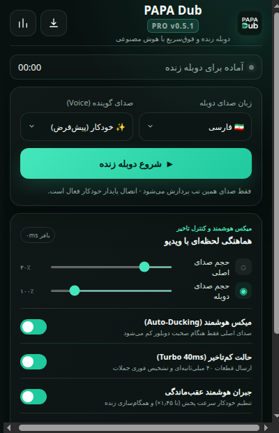
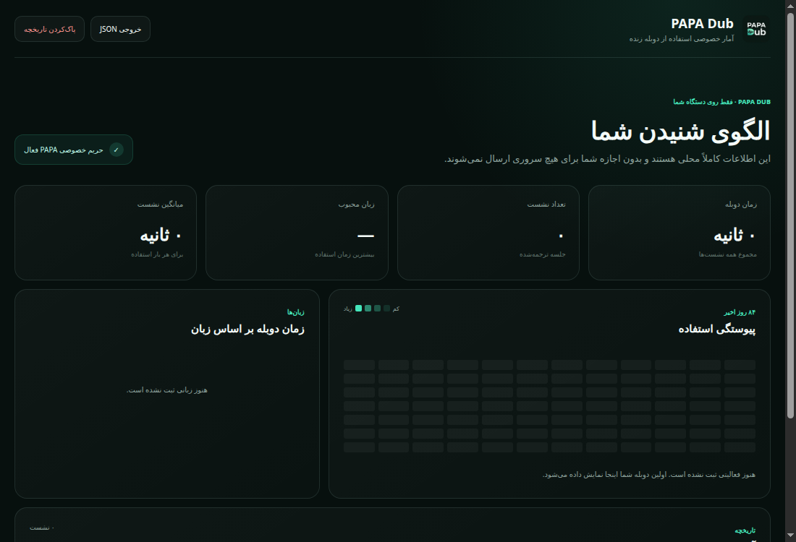

# PAPA Dub — Live AI Dubbing (Ultra-Low-Latency Edition)

یک اکستنشن مستقل Manifest V3 با هویت **PAPA Dub** برای دوبله زنده و فوق‌سریع صدای تب مرورگر با Gemini Live API.

نسخه فعلی: **0.5.1**

## 📸 نمایی از برنامه | Screenshots

اسکرین‌شات‌های واقعی از خود اکستنشن در حال اجرا:

*Real screenshots of the running extension.*

<p align="center">
  
  
</p>

## بهینه‌سازی‌های کاهش تاخیر در نسخه 0.3.0

- **قطعات صوتی ۴۰ میلی‌ثانیه‌ای (Turbo 40ms PCM):** کاهش اندازه فریم‌های صوتی در `pcm-capture-worklet.js` از ۱۰۰ms (`1600` نمونه) به ۴۰ms (`640` نمونه) با بافر حلقه‌ای بدون تخصیص اضافه.
- **پیکربندی کم‌تاخیر تشخیص گفتار (`RealtimeInputConfig`):** تنظیم `START_SENSITIVITY_HIGH`، `END_SENSITIVITY_HIGH`، کاهش `silenceDurationMs` به ۲۴۰ میلی‌ثانیه و `prefixPaddingMs` به ۱۲۰ میلی‌ثانیه، و فعال‌سازی `NO_INTERRUPTION` تا صدای پس‌زمینه ویدیو باعث قطع شدن دوبله در حال پخش نشود.
- **اتصال موازی (Parallel Handshake):** برقراری اتصال WebSocket به Gemini هم‌زمان با دریافت استریم صوتی تب و بارگذاری AudioWorklet برای حذف مکث اولیه.
- **الگوریتم جبران هوشمند (`playbackRateFor` + `Smart Sync`):** شروع افزایش نرم سرعت پخش از آستانه ۰٫۳۵ ثانیه (تا سقف `1.45x`) و پرش خودکار از صف‌های عقب‌مانده بالای ۴٫۲ ثانیه برای حفظ هماهنگی لب‌خوانی.
- **زیرنویس آنی (`interimInputTranscription`):** دریافت متن میانی گوینده بلافاصله حین صحبت.

## نصب در Chrome

1. فایل ZIP را از حالت فشرده خارج کنید.
2. در مرورگر Chrome آدرس `chrome://extensions` را باز کنید.
3. گزینه **Developer mode** را فعال کنید.
4. روی **Load unpacked** بزنید و پوشه پروژه را انتخاب کنید.
5. یک تب دارای صدا باز کنید، روی آیکن **PAPA Dub** کلیک کنید و کلید Gemini API خود را وارد نمایید.

## اعتبارسنجی توسعه

```bash
node tools/validate.mjs
node tools/test-live-protocol.mjs
node --check background.js
node --check offscreen.js
node --check popup.js
node --check stats.js
```
